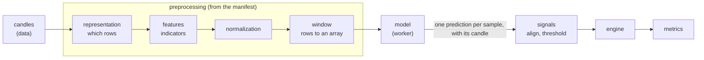

# Preprocessing and the model manifest

A trained model is a function from one input array to one output. The file says only the shape
of that array (`[None, 25, 23]`), never what is in it: which indicators, with which parameters,
normalized how, sampled when, in which column order. Feed it the wrong columns in the right
shape and it answers anyway, with numbers that look real. This document is the contract that
prevents that: the **manifest** stored with every model, and the `preprocessing` module that
turns candles into the model's input from it. It is the design agreed on 2026-10-18.

Built so far: the `preprocessing` module (the manifest and its checks, the catalog and the
first blocks: `candles@1`, `open@1` to `volume@1`, `none@1`, `window@1`), the catalog endpoint
`GET /api/v1/preprocessing/catalog`, and the manifest's JSON Schema,
[manifest.schema.json](manifest.schema.json). Still to come: the manifest stored with each
model, the worker that runs a model on its input, backtests that run with a model, and the
app's upload and builder. Architecture and module rules: [architecture.md](architecture.md).
The backtest that consumes the predictions: [engine.md](engine.md).

## Where it sits



- Every step is a block from a catalog, chosen and configured by the manifest. A new kind of
  preprocessing is a new block; the steps around it, the model runners and the engine stay as
  they are.
- Every sample knows the candle at whose close it was known. Its prediction goes back to that
  candle, so the engine keeps getting what it takes now: candles with one signal each.

## The manifest

A JSON document stored with each model (a JSONB column of `models`). A model uploaded without
one is kept but cannot run (`needs_setup`) until its manifest is added. Each backtest stores a
copy of the manifest it ran with, next to the model's SHA-256, so a later change to the
manifest never rewrites what an old backtest means.

No existing standard describes Renko bricks, indicator windows and column order, so the schema
is our own, and each manifest carries its version (`"version": 1`). It borrows from:

| Standard | What we take |
| --- | --- |
| MLflow model signature | the input and output shape, dtype and column names; an input example with its expected output |
| Hugging Face `preprocessor_config.json` | one document next to the weights that fully describes the input |
| Qlib data handler config | the features and the processing steps as data, each a catalog name plus parameters |
| Model Cards | what the model was trained on and when, for people |

### Fields

| Field | Meaning |
| --- | --- |
| `version` | `1`, the only version so far: a manifest of another version is refused, and one that still has the old field `"schema": "candlestack.manifest/1"` is told to replace it with `"version": 1` |
| `input.timeframe`, `input.session` | the candles the model expects: a timeframe of the market data (`30m`), and `regular` (US trading hours) or `24/7` (around the clock, as crypto trades) |
| `input.representation` | which rows the model sees: a catalog block and its parameters (`candles@1`, `renko@1`, ...) |
| `input.features` | the columns in their exact order: each a name (not `ts`, the time of a row), a catalog block (`rsi@1`), its parameters and its normalization (`none@1` when left out) |
| `input.window` | the parameters of `window@1`: `length`, how many rows make one sample (1 to 1000), and `last`, the rule for the last row (`closed`, the default, or `current`) |
| `signature.input`, `signature.output` | shape without the batch axis, and dtype (`float32` only); must equal what the model file says |
| `signature.output.meaning` | `score`: the sign is the direction, the size is compared with the threshold |
| `example` | optional: samples of the model's input with the output the model must give for each ([below](#the-example-field)) |
| `about` | free text for people, as strings: trained on which instruments, which period, notes |

Catalog names carry a version (`aroon@1`): one indicator name gives different numbers in
different libraries and versions (the supervisor's Aroon, Keltner and OBV differ from
`ta` 0.11's, [research #118]), so a manifest names our exact implementation, never "Aroon".
Names people see (blocks, templates, messages) say what a thing is or which models it belongs
to, never whose research it came from: the normalization of the BLESK models is `blesk-norm@1`.

The JSON Schema, [manifest.schema.json](manifest.schema.json), is generated from the code
(from `backend/`: `uv run python -m candlestack.preprocessing.schema > ../docs/manifest.schema.json`),
and a unit test fails when it is stale. It checks the form only, strictly: `"25"` is not a
number and an unknown field is refused. Which blocks exist and what their parameters are is
the catalog's (check 2 below), so a manifest of blocks still to come parses and is reported
as not runnable.

### The `example` field

`example` is a batch of the model's own input, already preprocessed, with what the model gives
for it: `input` is `[samples][rows][features]` and `output` is `[samples][1]`, finite numbers,
at least one sample. The shape of `input` must be the number of samples followed by
`signature.input`, and the shape of `output` the same number followed by `signature.output`.
For a model whose `signature.input` is `[2, 3]`, one sample:
`"example": {"input": [[[1, 2, 3], [4, 5, 6]]], "output": [[0.12]]}`.

### Example: no preprocessing

The first blocks, with which the whole chain is built and tested: every candle is a row, the
features are the raw prices, nothing is normalized, a sample is the last 25 candles.

```json
{
  "version": 1,
  "input": {
    "timeframe": "30m",
    "session": "regular",
    "representation": {"id": "candles@1"},
    "features": [
      {"name": "open", "id": "open@1", "norm": {"id": "none@1"}},
      {"name": "high", "id": "high@1", "norm": {"id": "none@1"}},
      {"name": "low", "id": "low@1", "norm": {"id": "none@1"}},
      {"name": "close", "id": "close@1", "norm": {"id": "none@1"}},
      {"name": "volume", "id": "volume@1", "norm": {"id": "none@1"}}
    ],
    "window": {"length": 25}
  },
  "signature": {
    "input": {"shape": [25, 5], "dtype": "float32"},
    "output": {"shape": [1], "dtype": "float32", "meaning": "score"}
  },
  "about": {"note": "Test model for the pipeline"}
}
```

### Example: the BLESK NO-VOL models (25 x 23)

What the same schema says for the BLESK NO-VOL models, as far as research knows their pipeline
([research #117]): indicators on the 30-minute candles, Renko bricks of 0.6 x ATR(14) of the
brick's first candle, rows of three bricks taken at the candle where the third one ends, a
window of the last 24 finished rows and the current one. It cannot run yet: the catalog has
none of its blocks but `none@1`, and the normalization formulas are not known.

The features are shortened to three here, so as written this manifest fails the signature
check (3 features give `[25, 3]`, not `[25, 23]`). The full manifest has all 23, in this order
([research #117]): `bb_bbh, bb_bbl, kch_high, kch_low, squeeze, rsi, roc, tsi, atr, adx,
aroon_up, aroon, aroon_down, sma, ema20, ema50, macd_diff, direction, rel_open, rel_high,
rel_low, rel_close, is_last_bar`.

```json
{
  "version": 1,
  "input": {
    "timeframe": "30m",
    "session": "regular",
    "representation": {
      "id": "renko-triples@1",
      "params": {"atr_multiple": 0.6, "atr_window": 14, "atr_at": "brick_start"}
    },
    "features": [
      {"name": "bb_bbh", "id": "bollinger-high@1", "params": {"window": 20, "dev": 2}, "norm": {"id": "blesk-norm@1"}},
      {"name": "rsi", "id": "rsi@1", "params": {"window": 20}, "norm": {"id": "blesk-norm@1"}},
      {"name": "direction", "id": "renko-direction@1"}
    ],
    "window": {"length": 25, "last": "current"}
  },
  "signature": {
    "input": {"shape": [25, 23], "dtype": "float32"},
    "output": {"shape": [1], "dtype": "float32", "meaning": "score"}
  },
  "about": {"trained_on": "S&P 500 stocks", "period": "2016-01-07..2022-12-30"}
}
```

### What the user chooses

| Fixed by the manifest | Chosen for each backtest |
| --- | --- |
| timeframe, representation, brick size, features and their order, indicator parameters, normalization, window | the instrument (one per backtest), period, how predictions become a signal (calibration, smoothing, threshold, hysteresis or k-means, long only, confirmation, holding period), stop loss, drawdown stop, fill, fees, slippage, benchmark; position sizing later |

A trained model only works on the input it was trained on, so the builder shows the manifest's
input as read only. Comparing Renko with Kagi, or one architecture with another (TSMixer,
StockMixer, the supervisor's MLP), means comparing backtests of models trained on each, on the
Compare page, not a step of the builder. A mode that lets a user change inputs of a trained
model (say a brick of 0.2 instead of 0.6 x ATR) is left out for now; catalog parameters carry a
`tunable` flag from the start, so it can be added without changing the schema.

### The builder

The model comes first, because it fixes the most: the timeframe, the session and the whole
input.

| Step | What happens |
| --- | --- |
| 1. Model | one of the user's models, or Upload model, which opens the upload below and comes back with the new model chosen. Models without a manifest are shown but cannot be chosen ("needs a manifest", with Add manifest). The preprocessing is one read-only line under the chosen model, from its manifest: "Renko 0.6 x ATR · 23 features · window 25", with the full list on demand |
| 2. Data | one instrument and the period; the timeframe is the model's. What cannot work is disabled with the reason, such as an instrument without candles for the period and the warm-up |
| 3. Decision | how predictions become a signal ([engine.md](engine.md#signals)): threshold, long only or long and short, stop loss; under Advanced calibration (z-score, rank), smoothing (EMA), the rule (threshold, hysteresis, k-means), confirmation, minimum hold, drawdown stop |
| 4. Execution | honest fill (buy at the next candle's open, on by default), fees, slippage, benchmark |
| 5. Run | a summary of the four steps, each with Edit, the warnings, and Run |

### The upload

The model and its manifest are two files, `model.keras` (or `model.onnx`) and `manifest.json`;
both can be dropped at once, and the app tells which is which.

1. The model file: its checks run (the model checks below), and it shows what it takes and
   gives: "input [25, 23] · output [1]".
2. How to feed it, one of: upload `manifest.json`; pick a template ("BLESK NO-VOL
   25 x 23", "Raw candles 25 x 5"); or build it in a form from the catalog (blocks, order,
   window). Its checks run at once, and the two are compared side by side: "the manifest
   gives [25, 23], the model takes [25, 23]".
3. An example input with its output, optional: the model is `verified` when it matches.
4. Save. Step 2 can be skipped: the model is kept as `needs_setup`, and its manifest is added
   later from the Models page.

Each check shows as passed or failed with what is wrong, in plain words ("The model has 2
inputs; CandleStack takes models with one input"). Save is disabled while a check fails.

## The blocks

Every block is a plain function on Polars frames, like the backtest modules: it imports no
other module of the project and no server library. It is registered in the catalog under its
versioned name, with its step, a Pydantic model of its parameters, its warm-up (how many
earlier candles it needs; rows, for the window) and a short description. A feature also has a
display group (`Candle`, `Bands`, `Momentum`, `Trend`, `Volume`, `Brick`; `open@1` to
`volume@1` are `Candle`), and each block names its `tunable` parameters (none yet).
`GET /api/v1/preprocessing/catalog` serves the catalog, so the app builds its forms from it
and a new block needs no frontend change: each block with its id, step, description, `group`
(null except for features; a string, not an enum, so a new group breaks no client), its
warm-up as a short expression of its parameters (`"0"`, `"length - 1"`) and its parameters
(type, range, default, options, `tunable`).

| Step | In, out | Blocks, in the order they come |
| --- | --- | --- |
| representation | candles, rows: each row with `ts`, the candle at whose close it is known (labelled by its open time, [data.md](data.md#time)), and the row's own columns | `candles@1` (every candle a row); then `renko-triples@1`, `kagi@1`; later Heikin-Ashi, range bars, volume bars |
| features | rows, the same rows with one column per feature, computed on the candles (later optionally on the bricks) | `open@1` ... `volume@1`; then the indicators of the BLESK models |
| normalization | a column, the column scaled | `none@1`; then `blesk-norm@1`, a rolling z-score, price-relative; fitted numbers come only from the manifest, never from the backtest's own data |
| window | rows, a `float32` array `(samples, length, features)` and the `ts` of each sample | `window@1`: the last `length` rows up to each row; `last: closed` (the default) ends a sample at the last finished row, `last: current` at the row still forming, which needs rows that span several candles, so it is refused until such a representation exists |

- With `candles@1` every candle has a sample. With an event representation (Renko, Kagi) a
  candle without a new row repeats the last prediction: `signals.align(strict=False)` does
  this already ([engine.md](engine.md#signals)), so the signal holds and no order follows.
- Warm-up: the run asks the data module for enough candles before the period's first day: the
  longest warm-up of the representation and of a feature with its normalization, plus the
  window's `length - 1` rows. With `candles@1` the number is `exact`, and the build drops just
  that many rows. With rows that span several candles (Renko, Kagi) it is an `estimate` from
  the candles a row takes, so the run loads more and the report says how many the warm-up
  used.
- A row with a missing, NaN or infinite feature at the start is warm-up: it is dropped and
  counted. One after a complete row is an error, so the model never gets a sample with a hole
  in it.

## No look-ahead

A block looks ahead when a row up to candle t depends on a candle after t. The rule: a block
sees only candles up to the one it is computing (no centered windows, no `shift(-n)`, no
statistics over the whole series). One property test runs over every registered block and over
whole manifests: replace every candle after t with other random candles, run again, and every
row and sample up to t must be the same, as the engine's
`test_data_after_a_candle_changes_nothing_up_to_it` does for the loop. A new block is in that
test as soon as it is registered.

## Where it runs

1. The backend loads the candles (it has the network and the cache) and writes them to a volume
   shared with the worker.
2. The worker, a container without network that sees the models read only, builds the input
   from the manifest, loads the model and writes the predictions with their `ts`.
3. The backend aligns them with the candles and runs `signals`, `engine` and `metrics`.

## Model formats

| Format | Status | How it runs |
| --- | --- | --- |
| Keras `.keras` | uploads now | Keras 3 in the worker; Keras files saved with the PyTorch or JAX backend load the same |
| ONNX `.onnx` | next | onnxruntime; standard operator domains only, no external data |
| PyTorch, TensorFlow, scikit-learn, XGBoost, LightGBM | through ONNX | the upload page shows the export (`torch.onnx.export`, `tf2onnx`, `skl2onnx`, `onnxmltools`) |
| pickle files (`.pt`, `.pth`, `.pkl`, `.joblib`), TensorFlow SavedModel | never | loading them can run any code |

The manifest does not depend on the format: a new format is a new runner in the worker, the
preprocessing stays the same.

## Checking a model with its manifest

Checks 1 to 3 read the files only and run on upload; 4 and 5 run the model in the worker.

1. **The model file.** The static check that runs now
   ([architecture.md](architecture.md#models)): a real model of allowed layers, with trained
   weights. Then its interface, from the file:
   - exactly one input and one output (a model with several inputs is refused for now);
   - the input is `[batch, rows, features]`: three axes, a fixed number of rows and of
     features, `float32`;
   - the output is `[batch, 1]`: one score per sample.
2. **The manifest.** Valid against the JSON Schema, which also caps the window at 1000 rows
   (the run loads the window's warm-up before its first day; 1000 rows of 30-minute candles
   are about 77 trading days); every block and version in the catalog and in its own step,
   each parameter of the right type and in its range; the feature names unique and none
   named `ts`; `signature.input` equal to `[window.length, number of features]` and
   `signature.output` equal to `[1]`; the shapes of the `example`.
3. **The model with the manifest.** `signature.input` equal to the model's input without the
   batch axis (`[25, 23]` and `[25, 23]`), `signature.output` equal to its output. The dtypes
   are not compared: the upload check reads none from the file, and the manifest allows only
   `float32`.
4. **A trial run** in the worker on built-in candles: the manifest builds the input, the model
   answers with finite numbers of the right shape.
5. **With an `example`:** the model's output for it within 1e-4 of the expected one. The model
   is then `verified`. This is the only check that catches columns in the wrong order, which
   the shape cannot.

## Tests

- Unit tests by hand on a few candles for every block.
- The look-ahead property test above.
- Golden tests on the supervisor's data, one per step so a failure points at it, run only where
  `CANDLESTACK_SUPERVISOR_DATA` names a local copy (as `test_supervisor.py`): candles to his
  `indicators`, to `all_renkos`, to `all_triples`, to `normalized`, to the model input
  `candles_x_values`, to his predictions. His data never goes into this repository.

## Open questions

Kept for the supervisor until the pipeline is built, then asked together with what else is
missing: his normalization formulas, the reward formula and `pocket_pivot`, the feature order
of the 25 x 7 models, the window rule of the 25 x 28 and 25 x 7 models, whether Renko is built
on the close or the high and low, and where his candles come from. Until then the research
tasks derive what they can from his data: normalization (#262), the Renko rules (#263), the
reward and `pocket_pivot` (#264), and his predictions reproduced from raw candles (#265).

[research #117]: https://github.com/candlestack-tech/research/blob/main/notes/117-supervisor-pipeline.md
[research #118]: https://github.com/candlestack-tech/research/blob/main/notes/118-indicators.md
