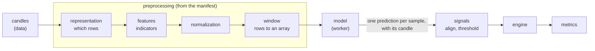

# Preprocessing and the model manifest

A trained model is a function from one input array to one output. The file says only the shape
of that array (`[None, 25, 23]`), never what is in it: which indicators, with which parameters,
normalized how, sampled when, in which column order. Feed it the wrong columns in the right
shape and it answers anyway, with numbers that look real. This document is the contract that
prevents that: the **manifest** stored with every model, and the `preprocessing` module that
turns candles into the model's input from it. It is the design agreed on 2026-10-18.

Built so far: the `preprocessing` module (the manifest and its checks, the catalog and the
first blocks: `candles@1`, `renko-triples@1` and `@2` ([below](#renko-triples)), `open@1` to
`volume@1`, `rel-open@1` to `rel-close@1` ([below](#the-relative-prices)), `session-last-candle@1`, the indicators of the BLESK models
with the `@2` versions of the recursive ones
([below](#the-indicators-of-the-blesk-models)), `renko-direction@1`, `none@1`, `blesk-norm@1`
([below](#the-normalization-of-the-blesk-models)), `window@1` with
`last` `closed` and `current`), the
catalog endpoint `GET /api/v1/preprocessing/catalog`, the manifest's JSON Schema,
[manifest.schema.json](manifest.schema.json), the manifest stored with each model, and the
worker that runs a model on its input with checks 4 and 5 below
([architecture.md](architecture.md#worker)), and the backtests that run a model on its input
([architecture.md](architecture.md#backtests)), and the app's upload and builder
([frontend.md](frontend.md#backtest-builder)). Architecture and module rules: [architecture.md](architecture.md).
The backtest that consumes the predictions: [engine.md](engine.md).

## Where it sits



- Every step is a block from a catalog, chosen and configured by the manifest. A new kind of
  preprocessing is a new block; the steps around it, the model runners and the engine stay as
  they are.
- Every sample knows the candle at whose close it was known. Its prediction goes back to that
  candle, so the engine keeps getting what it takes now: candles with one signal each.

## The manifest

A JSON document stored with each model (a JSONB column of `models`). A model uploaded without
one is kept but cannot run (`needs_setup`) until its manifest is added. Each backtest stores a
copy of the manifest it ran with, next to the model's SHA-256, so a later change to the
manifest never rewrites what an old backtest means.

No existing standard describes Renko bricks, indicator windows and column order, so the schema
is our own, and each manifest carries its version (`"version": 1`). It borrows from:

| Standard | What we take |
| --- | --- |
| MLflow model signature | the input and output shape, dtype and column names; an input example with its expected output |
| Hugging Face `preprocessor_config.json` | one document next to the weights that fully describes the input |
| Qlib data handler config | the features and the processing steps as data, each a catalog name plus parameters |
| Model Cards | what the model was trained on and when, for people |

### Fields

| Field | Meaning |
| --- | --- |
| `version` | `1`, the only version so far: a manifest of another version is refused, and one that still has the old field `"schema": "candlestack.manifest/1"` is told to replace it with `"version": 1` |
| `input.timeframe`, `input.session` | the candles the model expects: a timeframe of the market data (`30m`), and `regular` (US trading hours) or `24/7` (around the clock, as crypto trades) |
| `input.representation` | which rows the model sees: a catalog block and its parameters (`candles@1`, `renko@1`, ...) |
| `input.features` | the columns in their exact order: each a name (not `ts`, the time of a row, nor `row_id`, the id of a row still forming), a catalog block (`rsi@1`), its parameters and its normalization (`none@1` when left out) |
| `input.window` | the parameters of `window@1`: `length`, how many rows make one sample (1 to 1000), and `last`, the rule for the last row (`closed`, the default, for rows finished at their candle such as `candles@1`; `current` for rows that span several candles such as `renko-triples@1`) |
| `signature.input`, `signature.output` | shape without the batch axis, and dtype (`float32` only); must equal what the model file says |
| `signature.output.meaning` | `score`: the sign is the direction, the size is compared with the threshold |
| `example` | optional: samples of the model's input with the output the model must give for each ([below](#the-example-field)) |
| `about` | free text for people, as strings: trained on which instruments, which period, notes |

Catalog names carry a version (`aroon@1`): one indicator name gives different numbers in
different libraries and versions (the supervisor's Aroon, Keltner and OBV differ from
`ta` 0.11's, [research #118]), so a manifest names our exact implementation, never "Aroon".
Names people see (blocks, templates, messages) say what a thing is or which models it belongs
to, never whose research it came from: the normalization of the BLESK models is `blesk-norm@1`.

The JSON Schema, [manifest.schema.json](manifest.schema.json), is generated from the code
(from `backend/`: `uv run python -m candlestack.preprocessing.schema > ../docs/manifest.schema.json`),
and a unit test fails when it is stale. It checks the form only, strictly: `"25"` is not a
number and an unknown field is refused. Which blocks exist and what their parameters are is
the catalog's (check 2 below), so a manifest of blocks still to come parses and is reported
as not runnable.

### The `example` field

`example` is a batch of the model's own input, already preprocessed, with what the model gives
for it: `input` is `[samples][rows][features]` and `output` is `[samples][1]`, finite numbers,
at least one sample. The shape of `input` must be the number of samples followed by
`signature.input`, and the shape of `output` the same number followed by `signature.output`.
For a model whose `signature.input` is `[2, 3]`, one sample:
`"example": {"input": [[[1, 2, 3], [4, 5, 6]]], "output": [[0.12]]}`.

### Example: no preprocessing

The first blocks, with which the whole chain is built and tested: every candle is a row, the
features are the raw prices, nothing is normalized, a sample is the last 25 candles.

```json
{
  "version": 1,
  "input": {
    "timeframe": "30m",
    "session": "regular",
    "representation": {"id": "candles@1"},
    "features": [
      {"name": "open", "id": "open@1", "norm": {"id": "none@1"}},
      {"name": "high", "id": "high@1", "norm": {"id": "none@1"}},
      {"name": "low", "id": "low@1", "norm": {"id": "none@1"}},
      {"name": "close", "id": "close@1", "norm": {"id": "none@1"}},
      {"name": "volume", "id": "volume@1", "norm": {"id": "none@1"}}
    ],
    "window": {"length": 25}
  },
  "signature": {
    "input": {"shape": [25, 5], "dtype": "float32"},
    "output": {"shape": [1], "dtype": "float32", "meaning": "score"}
  },
  "about": {"note": "Test model for the pipeline"}
}
```

### Example: the BLESK NO-VOL models (25 x 23)

What the same schema says for the BLESK NO-VOL models, as far as research knows their pipeline
([research #117], [research #263], [research #265]): indicators on the 30-minute candles, the
recursive ones started as TA-Lib starts them (the `@2` blocks), Renko bricks of 0.6 x TA-Lib's
ATR(14) of the brick's first candle from the candle 49, rows of three bricks taken at the
candle where the third one ends, a window of the last 24 finished rows and the current one,
each feature scaled by `blesk-norm@1` ([below](#the-normalization-of-the-blesk-models)). The
catalog has every block of it, so the full manifest of the 23 features builds the `[25, 23]`
input from raw candles: on the candles of the BLESK data it gives the normalized features of
its triples ([below](#the-normalization-of-the-blesk-models)).

The features are shortened to four here, so as written this manifest fails the signature
check (4 features give `[25, 4]`, not `[25, 23]`). The full manifest has all 23, in this order
([research #117]): `bb_bbh, bb_bbl, kch_high, kch_low, squeeze, rsi, roc, tsi, atr, adx,
aroon_up, aroon, aroon_down, sma, ema20, ema50, macd_diff, direction, rel_open, rel_high,
rel_low, rel_close, is_last_bar`, with `rsi@2`, `tsi@2`, `atr@2`, `adx@2`, `ema@2` and
`macd-diff@2` for the recursive ones. Here `direction` and `is_last_bar` keep the default
`none@1`, which gives the same numbers: `blesk-norm@1` leaves them as they are.

```json
{
  "version": 1,
  "input": {
    "timeframe": "30m",
    "session": "regular",
    "representation": {
      "id": "renko-triples@2",
      "params": {"atr_multiple": 0.6, "atr_window": 14, "atr_at": "brick_start", "first_brick": 49}
    },
    "features": [
      {"name": "bb_bbh", "id": "bollinger-high@1", "params": {"window": 20, "dev": 2}, "norm": {"id": "blesk-norm@1"}},
      {"name": "rsi", "id": "rsi@2", "params": {"window": 20}, "norm": {"id": "blesk-norm@1"}},
      {"name": "direction", "id": "renko-direction@1"},
      {"name": "is_last_bar", "id": "session-last-candle@1"}
    ],
    "window": {"length": 25, "last": "current"}
  },
  "signature": {
    "input": {"shape": [25, 23], "dtype": "float32"},
    "output": {"shape": [1], "dtype": "float32", "meaning": "score"}
  },
  "about": {"trained_on": "S&P 500 stocks", "period": "2016-01-07..2022-12-30"}
}
```

### What the user chooses

| Fixed by the manifest | Chosen for each backtest |
| --- | --- |
| timeframe, representation, brick size, features and their order, indicator parameters, normalization, window | the instrument (one per backtest), period, how predictions become a signal (calibration, smoothing, threshold, hysteresis or k-means, long only, confirmation, holding period), stop loss, drawdown stop, fill, fees, slippage, benchmark; position sizing later |

A trained model only works on the input it was trained on, so the builder shows the manifest's
input as read only. Comparing Renko with Kagi, or one architecture with another (TSMixer,
StockMixer, the supervisor's MLP), means comparing backtests of models trained on each, on the
Compare page, not a step of the builder. A mode that lets a user change inputs of a trained
model (say a brick of 0.2 instead of 0.6 x ATR) is left out for now; catalog parameters carry a
`tunable` flag from the start, so it can be added without changing the schema.

### The builder

The model comes first, because it fixes the most: the timeframe, the session and the whole
input.

| Step | What happens |
| --- | --- |
| 1. Model | one of the user's models, or Upload model, which opens the upload below and comes back with the new model chosen. Models without a manifest are shown but cannot be chosen ("needs a manifest", with Add manifest). The preprocessing is one read-only line under the chosen model, from its manifest: "Renko 0.6 x ATR · 23 features · window 25", with the full list on demand |
| 2. Data | one instrument and the period; the timeframe is the model's. What cannot work is disabled with the reason, such as an instrument without candles for the period and the warm-up |
| 3. Decision | how predictions become a signal ([engine.md](engine.md#signals)): threshold, long only or long and short, stop loss; under Advanced calibration (z-score, rank), smoothing (EMA), the rule (threshold, hysteresis, k-means), confirmation, minimum hold, drawdown stop |
| 4. Execution | honest fill (buy at the next candle's open, on by default), fees, slippage, benchmark |
| 5. Run | a summary of the four steps, each with Edit, the warnings, and Run |

### The upload

The model and its manifest are two files, `model.keras` (or `model.onnx`) and `manifest.json`;
both can be dropped at once, and the app tells which is which. They are two requests: the
model file is uploaded and kept first (`POST /api/v1/models`), then its manifest is added to
it (`PUT /api/v1/models/{model_id}/manifest`, [architecture.md](architecture.md#models)).

1. The model file: its checks run (the model checks below), and it shows what it takes and
   gives: "input [25, 23] · output [1]".
2. How to feed it, one of: upload `manifest.json`; pick a template ("BLESK NO-VOL
   25 x 23", "Raw candles 25 x 5"); or build it in a form from the catalog (blocks, order,
   window). Its checks run at once (checks 2 and 3 below), and the two are compared side by
   side: "the manifest gives [25, 23], the model takes [25, 23]". The manifest is kept only
   when every check passed, and the model is then `ready`. An `example` in it is optional:
   the trial run in the worker (checks 4 and 5 below), which starts once the manifest is kept,
   compares it, and the model is `verified` when it matches; a trial run that fails leaves
   the model `ready` with its error.
3. Add model, once the manifest is kept: a model needs its manifest to be added, and closing
   the dialog before Add model deletes the model it uploaded. The API can still hold a model
   without one (`needs_setup`), whose manifest is added later from the Models page ("Add
   manifest"). A manifest added again replaces the one the model had, and the model is `ready`
   until a trial run verifies it again.

Each check shows as passed or failed with what is wrong, in plain words ("The model has 2
inputs; CandleStack takes models with one input"), one sentence for each thing wrong: at most
10, then how many more, so a manifest wrong throughout cannot flood the page. Add model (Save,
when a manifest is added later) is disabled while a check fails.

## The blocks

Every block is a plain function on Polars frames, like the backtest modules: it imports no
other module of the project and no server library. It is registered in the catalog under its
versioned name, with its step, a Pydantic model of its parameters, its warm-up (how many
earlier candles it needs; rows, for the window) and a short description. A feature also has a
display group (`Candle`, `Bands`, `Momentum`, `Trend`, `Volume`, `Brick`; `open@1` to
`volume@1`, `rel-open@1` to `rel-close@1` and `session-last-candle@1` are `Candle`), and each block names its `tunable` parameters (none yet).
`GET /api/v1/preprocessing/catalog` serves the catalog, so the app builds its forms from it
and a new block needs no frontend change: each block with its id, step, description, `group`
(null except for features; a string, not an enum, so a new group breaks no client), its
warm-up as a short expression of its parameters (`"0"`, `"length - 1"`) and its parameters
(type, range, default, options, `tunable`).

| Step | In, out | Blocks, in the order they come |
| --- | --- | --- |
| representation | candles, rows: each row with `ts`, the candle at whose close it is known (labelled by its open time, [data.md](data.md#time)), and the row's own columns; rows that span several candles also give `row_id`, the same on the rows of one row still forming | `candles@1` (every candle a row); `renko-triples@1` and `renko-triples@2` (rows of three Renko bricks, one a candle, [below](#renko-triples)); then `kagi@1`; later Heikin-Ashi, range bars, volume bars |
| features | rows, the same rows with one column per feature, computed on the candles and taken at each row's candle, or for a feature of the rows read from the rows | `open@1` ... `volume@1`; `rel-open@1` ... `rel-close@1` ([below](#the-relative-prices)); `session-last-candle@1` (1 on the last candle of its session, [below](#the-last-candle-of-a-session)); the indicators of the BLESK models ([below](#the-indicators-of-the-blesk-models)); `renko-direction@1`, a feature of the rows of `renko-triples@1` and `@2` |
| normalization | a feature's column of the rows, the close of each row's candle (the candle its features are taken at) and the feature's block; the column scaled. The close goes to the normalization only, never into the rows, so it takes no feature's name and the window never sees it | `none@1`; `blesk-norm@1` (the BLESK models' scaling, a rule per feature, [below](#the-normalization-of-the-blesk-models)); then a rolling z-score, price-relative; fitted numbers come only from the manifest, never from the backtest's own data |
| window | rows, a `float32` array `(samples, length, features)` and the `ts` of each sample | `window@1`: the last `length` rows up to each row. `last: closed` (the default) takes the `length` rows up to each row, each finished at its own candle, and needs rows that are (`candles@1`). `last: current` takes the `length - 1` most recent finished rows before each row and then the row, which may still be forming, and needs rows that span several candles (`renko-triples@1`); a manifest with the other rule is refused |

- With `candles@1` every candle has a sample. With an event representation (Renko, Kagi) a
  candle without a new row repeats the last prediction: `signals.align(strict=False)` does
  this already ([engine.md](engine.md#signals)), so the signal holds and no order follows.
- Memory: a sample copies its `length` rows, so all the samples at once take `length` times
  the memory of the rows (134 MB for 50000 samples of 25 x 28, 5.6 MB of rows). So the window
  keeps the rows and which rows each sample takes (`blocks.Samples`) and builds the samples of
  a range only when asked (`Samples.part`). The worker builds and predicts them a part of at
  most 32 MB at a time ([architecture.md](architecture.md#worker)); the samples, their `ts`
  and the dropped candles are the same as built at once.
- Warm-up: the run asks the data module for enough candles before the period's first day: the
  longest warm-up of the representation and of a feature with its normalization, plus the
  window's `length - 1` rows. A feature over the last `window` candles needs the candles before
  its first full window. A recursive one (an EMA, Wilder's smoothing) depends on every earlier
  candle, so its warm-up lasts until the first candles weigh less than 1e-6 in a value: after
  it, its values do not depend on where the candles start. The `@2` versions, started as
  TA-Lib does, wait only for TA-Lib's first value, which does depend on it
  ([below](#two-starts-of-the-recursive-indicators)). With `candles@1` the number is
  `exact`, and the build drops just that many rows. With rows that span several candles (Renko, Kagi) it is an `estimate` from
  the candles a row takes, so the run loads more and the report says how many the warm-up
  used. Renko bricks also depend on the candle they start on, which no warm-up removes
  ([below](#renko-triples)).
- A row with a missing, NaN or infinite feature at the start is warm-up: it is dropped and
  counted. One after a complete row is an error, so the model never gets a sample with a hole
  in it.

### The indicators of the BLESK models

The features of the BLESK NO-VOL models that are computed on the candles, in the order of their
input. Each gives the numbers the models were trained on: those of the `ta` library 0.11, its
quirks included, except Aroon, which is `ta` 0.10's ([research #118]), and the recursive ones,
which are TA-Lib's ([research #265]): their `@2` versions below start as TA-Lib does. They are
computed with Polars and NumPy, without `ta` or TA-Lib. The defaults are the BLESK
parameters; `ema20` and `ema50` are `ema@2` (or `ema@1`) with `window` 20 and 50.

| Input column | Block | Parameters (defaults) | Warm-up (candles) | Group |
| --- | --- | --- | --- | --- |
| `bb_bbh`, `bb_bbl` | `bollinger-high@1`, `bollinger-low@1`: the mean close plus and minus `dev` standard deviations of the population | `window` 20, `dev` 2 | `window - 1` | Bands |
| `kch_high`, `kch_low` | `keltner-high@1`, `keltner-low@1`: `ta`'s original Keltner channel, the means of `(4 high - 2 low + close) / 3` and `(4 low - 2 high + close) / 3`, without an ATR or a multiplier | `window` 20 | `window - 1` | Bands |
| `squeeze` | `squeeze@1`: 1 when both Bollinger bands lie inside the channel of the mean close plus and minus `keltner_multiplier` mean true ranges, else 0 | `bollinger_window` 20, `bollinger_dev` 2, `keltner_window` 20, `keltner_atr_window` 20, `keltner_multiplier` 1.5 | `max(bollinger_window - 1, keltner_window - 1, keltner_atr_window)` | Bands |
| `rsi` | `rsi@1`: Wilder's smoothing of the rises and falls of the close; 0 once the close stayed the same so long that the mean rise and the mean fall add up to less than 1e-14 (a stock not yet listed, or suspended), as in the BLESK data | `window` 20 | `14 * window` | Momentum |
| `roc` | `roc@1`: the change of the close from `window` candles before, in percent | `window` 20 | `window` | Momentum |
| `tsi` | `tsi@1`: the close's change smoothed by an EMA of `slow`, then of `fast` candles, over its absolute value smoothed the same way, in percent | `slow` 25, `fast` 13 | `7 * (slow + fast)` | Momentum |
| `atr` | `atr@1`: Wilder's smoothing of the true range, seeded with the mean of the first `window` | `window` 14 | `15 * window - 1` | Bands |
| `adx` | `adx@1`: `ta`'s average directional index, the directional movements smoothed by Wilder and their index smoothed again | `window` 14 | `20 * window` | Trend |
| `aroon_up`, `aroon`, `aroon_down` | `aroon-up@1`, `aroon@1` (up minus down), `aroon-down@1`: on the close, 100 x (the position of the highest or lowest close in the last `window`, the oldest at 1) / `window` | `window` 25 | `window - 1` | Trend |
| `sma` | `sma@1`: the mean close | `window` 20 | `window - 1` | Trend |
| `ema20`, `ema50` | `ema@1`: the EMA of the close from the first candle | `window` 20 | `7 * window` | Trend |
| `macd_diff` | `macd-diff@1`: the MACD histogram, the fast EMA minus the slow EMA minus the signal EMA of that | `fast` 12, `slow` 26, `signal` 9 | `7 * (max(fast, slow) + signal)` | Trend |

The `@2` versions of the recursive ones, with the same parameters and groups, as TA-Lib computes
them:

| Input column | Block | Warm-up (candles) |
| --- | --- | --- |
| `rsi` | `rsi@2`: `100 * rise / (rise + fall)` of the mean rise and fall, Wilder's smoothing from the means of the `window` changes after the first candle; 0 on long flat stretches as `rsi@1` | `window` |
| `tsi` | `tsi@2`: as `tsi@1`, with two TA-Lib EMAs, the first from the second candle's change on | `slow + fast - 1` |
| `atr` | `atr@2`: Wilder's smoothing of the true range from the mean of the true ranges of the candles 1 to `window` | `window` |
| `adx` | `adx@2`: TA-Lib's ADX: the true range and the directional movements summed over the candles 1 to `window - 1`, then smoothed by Wilder; the directional index averaged over its first `window` candles, then smoothed by Wilder; where the smoothed true range or the sum of the directional indicators is under 1e-14 the index counts 0 in that average and leaves the ADX as it was afterwards | `2 * window - 1` |
| `ema20`, `ema50` | `ema@2`: the EMA of the close from the mean of the first `window` closes | `window - 1` |
| `macd_diff` | `macd-diff@2`: TA-Lib's MACD histogram: the fast and the slow EMA both start at the candle `slow - 1`, each from the mean of its own window up to it, the signal EMA from the mean of the first `signal` MACDs; the shorter of `fast` and `slow` is the fast one | `max(fast, slow) + signal - 2` |

The recursive warm-ups of `@1` come from the smoothing: after `7 * window` candles of an EMA,
or `14 * window` of Wilder's smoothing, the first candles weigh less than e^-14, under 1e-6.
The ADX smooths twice, and the TSI and the MACD chain two EMAs, so theirs are longer. With the
defaults the longest is 280 candles (RSI and ADX), about 22 trading days of 30-minute candles.

#### Two starts of the recursive indicators

An EMA or Wilder's smoothing needs a first value. `ta` 0.11, which the `@1` blocks follow,
starts the EMA and the RSI from the first candle, and the ATR from the mean of the first
`window` true ranges, the first candle's included. TA-Lib starts each from the mean of its
first window, and skips the first candle where it has no close before it ([research #265]).
The BLESK data took its recursive indicators from TA-Lib, so only the `@2` blocks give them on
every candle from its first.

- **After the `@1` warm-up the two agree** within 1e-6: a backtest gets the same features from
  either, past the warm-up. Before it they differ, and so do the Renko bricks, which depend on
  every ATR before them ([below](#renko-triples)).
- **The `@2` warm-up is TA-Lib's**, the candles before its first value. That value depends on
  where the candles start, as TA-Lib's does, so a backtest's first candles see the `@2` values
  of the history it loaded. With the defaults the longest is 49 candles (the EMA of 50).
- The golden tests (`tests/unit/preprocessing/test_supervisor.py`) give the BLESK `rsi`,
  `tsi`, `atr`, `adx`, `ema20`, `ema50` and `macd_diff` from the `@2` blocks on every row of
  all 521 stocks, from the first, within `rtol` 1e-6 and `atol` 1e-8.

Not here: `direction` is `renko-direction@1`, the direction of a Renko triple
([below](#renko-triples)). `rel_open`, `rel_high`, `rel_low` and `rel_close` are
`rel-open@1` to `rel-close@1`, [below](#the-relative-prices). `is_last_bar` is
`session-last-candle@1`, [below](#the-last-candle-of-a-session).

### The relative prices

The BLESK models take the candle's prices free of the price level, as the columns `rel_open`,
`rel_high`, `rel_low` and `rel_close` of his normalized data ([research #117]):

| Block | Value | Warm-up |
| --- | --- | --- |
| `rel-open@1` | open / close - 1 | 0 |
| `rel-high@1` | high / close - 1 | 0 |
| `rel-low@1` | low / close - 1 | 0 |
| `rel-close@1` | close / the previous candle's close - 1, across sessions too | 1 |

They come from the candle's own prices, and his triples take them at the candle where the
third brick ends, as every other feature; the model gets them as they are, scaled no further.
They equal his values on every candle of AAPL and TSLA (34 860 each) but his first
`rel_close`, which has no previous close in his data and holds 1. The tests against his data
are in `tests/unit/preprocessing/test_supervisor.py`.

### The last candle of a session

`session-last-candle@1` gives 1 on the last candle of its trading session and 0 on the others,
with no parameters and no warm-up (group `Candle`); it is the `is_last_bar` of the BLESK models,
which equals the `end_bar` of their candles ([research #118]). Which candle is the last needs
the exchange calendar with its early closes, and `preprocessing` has no network, so the block
does not work it out: the data module marks the candle whose bin ends at the session close
([data.md](data.md#last-candle-of-a-session)) and the mark comes with the candles, the Boolean
column `session_last` next to OHLCV, through the job's candles file to the worker
([architecture.md](architecture.md#worker)). The mark is known when the candle closes, so the
block does not look ahead; a day whose last candle is missing has none marked.

Crypto candles have no sessions, so the block needs `"session": "regular"`: a manifest of
`24/7` candles that names it fails the `catalog` check ("candles have no sessions"), and
candles without the marks make the build fail rather than give a column of zeros, which a
model trained on stock sessions would read as "never the last candle".

### Renko triples

`renko-triples@1` makes the rows of the BLESK models: rows of three Renko bricks, one per
candle. Its rules are research #263's ([research #263]), which rebuild the bricks and triples
of the BLESK data on all 521 of its stocks (below). `renko-triples@2` makes the same rows with
the bricks of the BLESK data itself: TA-Lib's ATR (`atr@2`) and the first brick where the
BLESK data has it ([research #265]).

| Parameter | Default | Meaning |
| --- | --- | --- |
| `atr_multiple` | 0.6 | the height of a brick in ATRs, above 0 and at most 10 |
| `atr_window` | 14 | the candles of the ATR, `atr@1`'s window (`atr@2`'s for `@2`), 2 to 1000 |
| `atr_at` | `brick_start` | the candle whose ATR sizes a brick: the one that starts it, the only option |
| `first_brick` | 49 | `@2` only: the candle of the first brick, counted from 0, never before the ATR's first value (the candle `atr_window`); 49 is the first candle where every indicator of the BLESK data has a value, the first of the EMA of 50 closes |

- **Bricks** are built on the close of each candle, in float64. A brick is `atr_multiple`
  times the ATR (`atr@1`, or `atr@2` for `@2`) of the candle that starts it high, and never
  changes afterwards.
- **The first brick** lies on the mid price of its candle, `(high + low) / 2`, one height
  high, without a direction: the first candle out of the ATR's warm-up for `@1`, the candle
  `first_brick` for `@2`.
- **A new brick**: on each later candle the close is compared with the current brick
  `[bottom, top]`. Inside it, edges included, nothing happens. Above `top` the new brick is the
  cell that holds the close on a grid of the candle's brick height, anchored at `top`, and
  the whole cells jumped over are counted as `skipped`; below `bottom` the same downwards. A
  reversal needs no more than a continuation, one candle makes at most one brick however far
  the close moved, and an overnight or weekend gap is a move like any other. A candle whose
  ATR is 0 (candles that never moved) starts no brick.
- **A row** is a triple: the two bricks before the current one and the current brick as it
  stands at a candle's close, one row per candle from the third brick on, known at that
  candle's close. Its columns: `ts`, `row_id` (the number of the current brick), `start` (the
  `ts` of the first brick's first candle), `direction` (half the middle brick's direction plus
  a quarter of the current one's: -0.75, -0.25, 0.25 or 0.75), and `bottom` and `top` (the
  lowest bottom and the highest top of the three).
- **Its features**: a feature of the candles takes its value at the row's candle (the
  indicators, `session-last-candle@1`); `renko-direction@1` is the row's `direction`, and
  needs `renko-triples@1` or `@2`.
- **Finished rows**: the rows of one `row_id` are one triple at successive candles, and the
  last of them is finished: the next candle starts another brick. That is known only at the
  next candle, so the rows carry no `finished` column. The window `last: current` tells a
  finished row by the next row, and never reads whether its own last row is finished. A
  sample is the 24 most recent finished rows before a candle's row and that row (research
  #117), one sample per candle from the first with 24 finished rows after the warm-up.

The **warm-up** is an `estimate`. The bricks of `@1` start on the first candle whose ATR is out
of its warm-up (`15 * atr_window - 1`, 209 candles for 14), so a brick's height is
`atr_multiple` times the `atr` feature of its first candle whatever candle the load starts on;
those of `@2` on the candle `max(first_brick, atr_window)`, 49 by default. The first row
waits for two more bricks, and a sample for 24 finished rows. A brick takes about
`1 + 2 * atr_multiple` candles: on the 30-minute candles of the BLESK data a brick of 0.6 ATR
takes 1.7 on average and under 1.8 on 95 % of the stocks, and the rule is above the 95 % of
every multiple from 0.2 to 3, so the estimate is rather too long than too short. With the
BLESK features of `@1` the warm-up is 350 candles (the EMA of 50) and then 53 for the 24 rows:
403 candles, about 31 trading days. With the `@2` blocks it is 54 candles (the first brick on
the candle 49, then two bricks) and then 53: 107 candles, about 8 trading days.

**The bricks depend on the whole history** the build sees: each brick is anchored at the one
before, back to the first brick on the first candle. The same candles always give the same
bricks, but a backtest of another period loads candles from another first candle and gets
other bricks, which mostly do not line up again. On the candles of the BLESK data from their
first one, `renko-triples@1` (its own ATR and first candle) lines up with the BLESK bricks for
good on 170 of its 521 stocks (12 of them from 2016, 35 only in 2026), and never on 351.
`renko-triples@2` gives the BLESK triples on every row of 385 stocks; on the others a close on
a grid line parts the bricks (R10, below), after which 67 line up again for good and 69 never
do. So the model sees bricks of the rules it was trained on, not the same bricks, and a
backtest's samples depend a little on its start date; two runs of one period are the same.

**Golden tests** (`tests/unit/preprocessing/test_supervisor_renko.py`, run where the BLESK
data is): on all 521 stocks the brick loop from the first candle of the BLESK indicators, with
the BLESK ATR and with `atr@2` of the BLESK candles, gives every row of its bricks (start,
bottom, top, direction, skipped, finished), and the triples built from them every row of the
structural columns of its triples (start, end, direction, finished, bottom, top and the OHLCV
of both candles). Two kinds of exception, each handled narrowly and the same with either ATR:
187 closes on 136 stocks that lie on a line of the brick's grid within float rounding (at most
5 a stock), where the BLESK arithmetic picked the cell on the other side (research #263, R10);
and 65 stocks whose bricks have no row for their first candle (R9).

### The normalization of the BLESK models

`blesk-norm@1` scales each feature as the BLESK models were trained ([research #262]): by a
rule of the feature's block, row by row, from the close of the row's candle (for a Renko
triple, the candle where its last brick stands, the one its features are taken at). It has no
parameters and no warm-up, and uses no statistic of a window or of the history, so it cannot
look ahead and needs no fitted numbers.

| Rule | Features (blocks) | Value |
| --- | --- | --- |
| a price level, in percent from the close | `bollinger-high@1`, `bollinger-low@1`, `keltner-high@1`, `keltner-low@1`, `sma@1`, `ema@1`, `ema@2` | (x / close - 1) x 100 |
| an oscillator, centered | `rsi@1`, `rsi@2`, `aroon-up@1`, `aroon-down@1`; `adx@1`, `adx@2` | x - 50; x - 25 |
| a range, in percent of the close | `atr@1`, `atr@2` | x / close x 100 |
| as it is | `squeeze@1`, `roc@1`, `tsi@1`, `tsi@2`, `aroon@1`, `macd-diff@1`, `macd-diff@2`, `renko-direction@1`, `session-last-candle@1`, `rel-open@1` ... `rel-close@1` | x |

A feature whose block has no rule (`open@1` ... `volume@1`, or a block added later) cannot take
it: the manifest fails the `catalog` check ("input.features[0].norm is blesk-norm@1, which has
no rule for open@1"), before anything runs. The rules live in `blocks.BLESK_RULES`; changing
one makes a new version (`blesk-norm@2`), as for every block.
The BLESK data also has `obv`, `mfi`, `vwap` and `cmf`, scaled in their own ways, which the
NO-VOL models do not take and the catalog does not have.

The evidence: research #262 reproduces every column of the BLESK normalized data from its
indicators with these rules on every row of four stocks, within 1.4e-14. The golden tests
(`tests/unit/preprocessing/test_supervisor.py`) give the BLESK normalized data from its
indicators on every row of AAPL and TSLA, and build the whole BLESK NO-VOL manifest above, of
the `@2` blocks, on the candles of all 521 stocks of the BLESK data: it gives every row of the
BLESK triples (17.7 million rows), the 22 features of the candle equal their normalized
features on every one of them, and the direction on the 16.4 million rows whose bricks line up
with the BLESK bricks, every row of 385 stocks (a close on a grid line parts the others,
[above](#renko-triples)). A price level is compared within 1e-4 percentage
points, 1e-6 of the close as for the indicators, since on stretches of one unchanged close
the BLESK Bollinger bands lie up to 2.1e-5 off it, float noise of their standard deviation.

## No look-ahead

A block looks ahead when a row up to candle t depends on a candle after t. The rule: a block
sees only candles up to the one it is computing (no centered windows, no `shift(-n)`, no
statistics over the whole series). One property test runs over every registered block and over
whole manifests: replace every candle after t with other random candles, run again, and every
row and sample up to t must be the same, as the engine's
`test_data_after_a_candle_changes_nothing_up_to_it` does for the loop. A new block is in that
test as soon as it is registered.

## Where it runs

1. The backend loads the candles (it has the network and the cache) and writes them to a volume
   shared with the worker, then hands it the job through the job queue (`jobs`).
2. The worker, a container without network that sees the models read only, builds the input
   from the manifest, loads the model and writes the predictions with their `ts`
   ([architecture.md](architecture.md#worker)).
3. The backend aligns them with the candles and runs `signals`, `engine` and `metrics`.

## Model formats

| Format | Status | How it runs |
| --- | --- | --- |
| Keras `.keras` | uploads now | Keras 3 in the worker; Keras files saved with the PyTorch or JAX backend load the same |
| ONNX `.onnx` | uploads now | onnxruntime on the CPU in the worker; standard operator domains only (`ai.onnx`, `ai.onnx.ml`), no external data, a dynamic batch axis |
| PyTorch, TensorFlow, scikit-learn, XGBoost, LightGBM | through ONNX | the upload page shows the export (`torch.onnx.export`, `tf2onnx`, `skl2onnx`, `onnxmltools`) |
| pickle files (`.pt`, `.pth`, `.pkl`, `.joblib`), TensorFlow SavedModel | never | loading them can run any code |

The manifest does not depend on the format: a new format is a new runner in the worker, the
preprocessing stays the same.

## Checking a model with its manifest

Checks 1 to 3 read the files only and run on upload; 4 and 5 run the model in the worker.

1. **The model file.** The static check that runs now
   ([architecture.md](architecture.md#models)): a real model of allowed layers (for ONNX, the
   standard operators only, every tensor inside the file), with trained weights. Then its
   interface, from the file:
   - exactly one input and one output (a model with several inputs is refused for now);
   - the input is `[batch, rows, features]`: three axes, a fixed number of rows and of
     features, `float32`;
   - the output is `[batch, 1]`: one score per sample.

   An ONNX file is refused at upload unless it has one float32 input and one float32 output,
   each with a dynamic batch axis and every other axis of a fixed size; a Keras file whose
   config does not say a shape plainly is kept with that shape unknown, and its manifest then
   cannot be compared (check 3).
2. **The manifest.** Valid against the JSON Schema, which also caps the window at 1000 rows
   (the run loads the window's warm-up before its first day; 1000 rows of 30-minute candles
   are about 77 trading days) and what a manifest lists, far above any real model's: 256
   features, 32 parameters of a block, 8 axes of a shape, block ids of 64 characters; every
   block and version in the catalog and in its own step (and `session-last-candle@1` only with
   the `regular` session, `blesk-norm@1` only on a feature it has a rule for),
   each parameter of the right type and in its range; the feature names unique and none
   named `ts`; `signature.input` equal to `[window.length, number of features]` and
   `signature.output` equal to `[1]`; the shapes of the `example`.
3. **The model with the manifest.** `signature.input` equal to the model's input without the
   batch axis (`[25, 23]` and `[25, 23]`), `signature.output` equal to its output. The dtypes
   are not compared: the upload check reads none from the file, and the manifest allows only
   `float32`.
4. **A trial run** in the worker on built-in candles: the manifest builds the input, the model
   answers with finite numbers of the right shape.
5. **With an `example`:** the model's output for it within 1e-4 of the expected one. The model
   is then `verified`. This is the only check that catches columns in the wrong order, which
   the shape cannot.

## Tests

- Unit tests by hand on a few candles for every block.
- The look-ahead property test above.
- Golden tests on the supervisor's data, one per step so a failure points at it, run only where
  `CANDLESTACK_SUPERVISOR_DATA` names a local copy (as `test_supervisor.py`): candles to his
  `indicators` and the session marks to his `end_bar` (built:
  `tests/unit/preprocessing/test_supervisor.py`), to `all_renkos` and to `all_triples`
  (built: `tests/unit/preprocessing/test_supervisor_renko.py`), to `normalized` and to the
  normalized features of `all_triples` (built: `tests/unit/preprocessing/test_supervisor.py`),
  to the model input `candles_x_values`, to his predictions. His data never goes into this repository.

## Open questions

Kept for the supervisor until the pipeline is built, then asked together with what else is
missing: the reward formula and `pocket_pivot`, the feature order
of the 25 x 7 models, the window rule of the 25 x 28 and 25 x 7 models, where his candles come
from, whether his recursive indicators come from TA-Lib, as research #265 finds, and of the
Renko bricks ([research #263]): why some stocks have
no row for their first candle, whether a close exactly on a brick's edge stays in the brick
(here it does), and the exact arithmetic of a close on a grid line. Until then the research
tasks derive what they can from his data: normalization (#262), the Renko rules (#263), the
reward and `pocket_pivot` (#264), and his predictions reproduced from raw candles (#265).

[research #117]: https://github.com/candlestack-tech/research/blob/main/notes/117-supervisor-pipeline.md
[research #118]: https://github.com/candlestack-tech/research/blob/main/notes/118-indicators.md
[research #262]: https://github.com/candlestack-tech/research/blob/main/notes/262-normalization.md
[research #263]: https://github.com/candlestack-tech/research/blob/main/notes/263-renko-rules.md
[research #265]: https://github.com/candlestack-tech/research/blob/main/notes/265-reproduce-predictions.md
